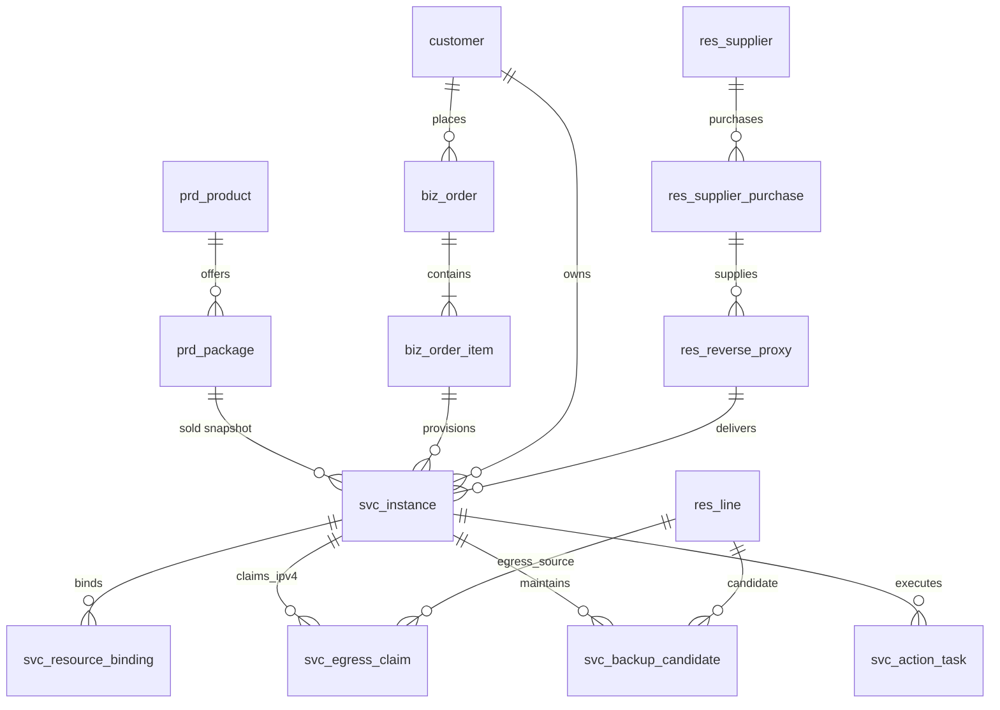

# V1.2 R3 数据模型修订说明（对原ER的增量）

状态：**数据库迁移脚本提案/需在PostgreSQL验证后启用生产**。对应迁移：`database/migration/V22__v12_round3_egress_grace_tasks.sql`。不得回写V1–V21。

## 字段与主数据归属
|实体|第三轮新增列或实体|关键原则|
|---|---|---|
|prd_package|grace_days（可空，非负）|只适用长效与独享；NULL不是0，未配置不能编造默认|
|svc_instance|grace_days_snapshot, grace_until_at, expiry_phase, delivery_stage, last_delivery_verified_at|服务快照不被套餐后续编辑覆盖；服务状态和外部探测分离|
|svc_egress_claim|service/customer/egress_ipv4/source_line/claim_mode/claim_status/held_until/verified_at|IPv4而非端口和线路是独享检查单位；保留/待释放也阻断他客复用|
|svc_backup_candidate|service/line/expected_ipv4/health/last_checked|只有业务候选关系，不表示ROS主备自动切换|
|svc_action_task|operation_key/action_type/task_status/stage/remote_operation/attempt_count/last_error|跨系统幂等、执行与补偿记录；SUCCEEDED要有真实证据|

## 并发与迁移风险
- 通过事务级advisory lock + 数据库触发器和部分唯一索引控制同IPv4的独享排他；应用层仍需预检、事务重校验与错误码映射。
- SHARED/EXCLUSIVE同表是目标模型。**旧占用表和存量服务并未自动回填**，不能据新增表为空判断当前IPv4可被重新售卖；首次正式切流需做历史数据核对。
- 原线路客户字段保留为兼容历史数据，但**新业务不可写入**；后续移除必须另立迁移和外部数据确认。
- 状态枚举中的停服保留独立于真实代理入口可用性；若产品接口未确认真实停服，不允许把数据库expiry_phase更改直接视作已停服。
- 随机单样本端口/IP不代表公网出口保证，必须取产品组真实对外出口及验证证据。
