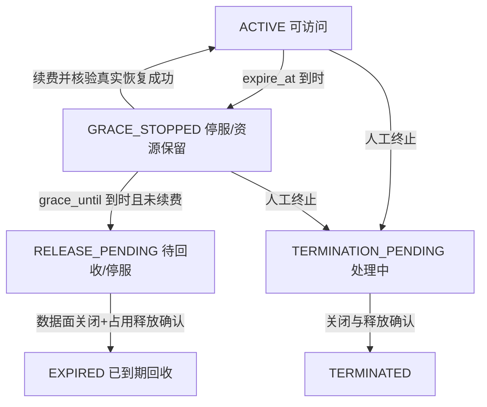
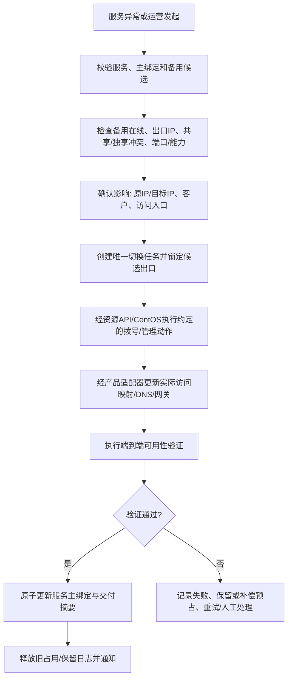
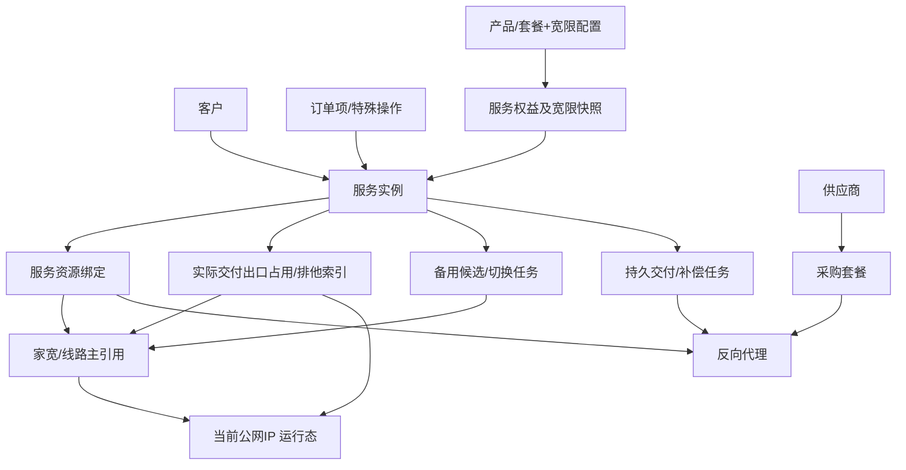

# IP代理管理平台 V1.2｜第一轮P0设计收敛（评审稿）

> 文档状态：**业务设计评审稿 / 非正式需求基线 / 尚未批准实施**  
> 范围：独享与长效出口占用、到期宽限期、备用线路与人工主备切换、统一服务生命周期、外部代理安全与交付补偿。  
> 约束：本轮只明确**业务规则、状态/数据关系、职责边界和验收标准**；不改正式Word、交互原型、数据库迁移或业务代码。第二轮做页面/字段细化；第三轮统一发布正式需求、原型与接口契约。  
> 时间：2026-10-14。依据当前竞品调研业务确认；不以竞品页面推断替代用户决策。

## 第二轮启动前的业务批准记录（2026-10-14）

**用户已批准三项第一轮原则**：
1. **独享IP**默认按公网出口**IPv4跨客户排他**，同一IPv4换端口不能绕过；同一客户多独享服务如何计数/复用仍待业务约定。
2. **续费宽限期**由长效套餐、独享套餐**分别独立配置天数**，不采用系统统一固定时长；具体默认天数、是否允许0、续费期限起点仍待确认。
3. **主备切换**当前只设计**人工发起**；不恢复ROS设备级主备和自动切换，实际动作执行方及跨ROS能力仍待IP资源API组/产品组确认。

此批准将Q01中“跨客户排他粒度”的选择、Q02中“套餐分别配置”的原则和Q06中“只做人工切换”的范围转为**已确认**；Q01的同客户复用、Q02的默认值和Q05的执行接口仍未定案。第一轮全文其他“[待确认]”不能因该批准自动标记为确定。

第二轮已经在[全模块页面总表](V1.2-P1-第二轮-全模块页面总表与统一交互规范.md)、[核心业务页面详规](V1.2-P1-第二轮-核心业务页面字段及交互详规.md)与[通用模块/验收矩阵](V1.2-P1-第二轮-通用模块与验收矩阵.md)落实上述三原则（设计稿），尚未修改正式Word/原型/接口及业务代码。

## 0. 依据、证据等级及变更边界

| 材料 | 本轮使用方式 |
|---|---|
| [正式V1.2 Word需求](../requirements/IP代理管理平台需求说明书-V1.2.docx) | 现行正式业务基线；重点核对§2.3、§6.5–6.10、§7.4–7.9、§8、§16、§17、§19 |
| [竞品分析报告](../research/competitors/caihong-2026-10-14/report.md) | 竞品观察与代码静态风险；D01–D03、D05、D09–D10为研发整改重要输入，但不能把静态发现视作已验证运行故障 |
| [用户业务确认](../research/competitors/caihong-2026-10-14/business-confirmations.md) | 本轮业务口径优先来源：五类产品、固定IP的共享/独享边界、手工通道、备用线路切换、宽限期停服保留、外部反向代理链等 |

**分层标记**：**[已确认]** = 用户已作决定；**[方案建议]** = 本轮提出的落地方案，需评审批准；**[待确认]** = 尚不足以定案的产品参数、身份口径或外部接口。已确认项可作为设计约束；方案建议与待确认项不得擅自当作已批准需求或数据库定稿。

**本轮明确不做**：恢复ROS主备/自动切换旧字段和旧接口；改变CentOS↔ROS当前1:1、ROS只拨号；把客户ID塞回线路主表；改成按五类产品建资源池；新增充值、人工实名认证二审、第二套内部资源故障告警；假定没有真实适配器也已真实交付。

## 1. 修订总览：旧规则与新业务口径的冲突

| ID | 正式Word位置 | 旧表述/设计风险 | 第一轮收敛方向 |
|---|---|---|---|
| P0-A | §2.3.3、§6.6、§8.2.2、§8.4.1、§16.5 | “独享线路”与“独享IP/出口”混用，独占线路未必等于出口IP不与他客共享 | 以**客户可使用的固定代理出口IP**作为独享承诺与全局排他校验对象；线路仅为资源来源与可操作主引用；是否需独立出口资源实体留给技术方案确认 |
| P0-B | §7.8、§8.7–8.9、§16.10、§19 | 到期即释放固定资源，缺少套餐宽限配置与停服保留状态 | 到期先阻断访问，长效/独享在套餐宽限期保留约定固定IP及占用；续费后验真恢复，宽限期结束再回收 |
| P0-C | §6.3、§8.5–8.9、§16.2、§17.2/17.8 | 删除旧ROS主备后没有备用线路业务与恢复入口 | 新增**服务级备用线路关系与人工切换任务**；ROS保持拨号角色，业务平台编排、资源API/CentOS与产品数据面按接口执行 |
| P0-D | §8.6–8.9、§16.10/16.13 | 状态变更与真实产品入口、凭证、绑定及到期任务未形成可验证闭环 | 按交付方式分别编排停用/恢复/续费/终止、期限同步、幂等及补偿；管理面状态不替代数据面可用性 |
| P0-E | §6.9–6.10、§8.4.2、§17.6–17.9 | 外部采购、代理、客户与服务之间的归属/期限/占用校验、失败处理需收紧 | 四方关联约束、变更保护、事务内资源锁、真实关闭/解绑结果和跨系统可恢复任务 |

## 2. P0-A：长效IP与独享IP——资源占用语义

### 2.1 商业承诺与身份边界

- **[已确认] 长效IP**：固定IP可在多个客户的服务中共享；具体可共享量须受产品/资源能力和约定规则限制，不等于无限共享。
- **[已确认] 独享IP**：某个客户在相应服务期内独享其代理**出口**，其他客户不能使用该出口；持续使用固定IP。**不意味着独占底层家宽总带宽**。
- **[已确认]** 线路与客户通过服务实例→资源绑定关联，不在家宽/线路主表设置客户归属；线路当前公网IP是可变化运行属性。
- **[方案建议]** 销售/服务承诺中的“固定IP”需记录业务交付IP及交付时刻；不能因线路自动上报新IP就静默改变客户的固定出口承诺。公网IP意外变化须进入“待恢复/待切换”处理，由受控操作完成实际访问入口更新和审计。
- **[待确认]** 某些实际产品是否以单个IPv4作为独享粒度，或以代理入口IP+协议/端口定义“出口”。**评审前默认采取更严格的“公网出口IPv4跨客户排他”校验**，不能依端口不同就放行他客复用。
- **[待确认]** 对外宣称固定IP的保障方式：底层线路固定公网IPv4、同IP备用资源、域名/网关间接入口，还是供应商固定能力；资源API与产品组需给出可验证能力声明。不能把动态拨号IP当作固定IP保证。

### 2.2 业务校验矩阵（拟定）

| 待开通/调整的出口 | 同一公网IPv4已有其他客户长效共享 | 同一公网IPv4已有其他客户独享 | 同一客户已有占用 |
|---|---|---|---|
| 长效（允许共享） | 可按共享容量/套餐规则评估 | **拒绝** | 可复用但须校验容量/服务数量 |
| 独享（跨客户排他） | **拒绝**，须先清空他客有效占用 | **拒绝** | 仅在同一客户内按批准的配额/复用规则评估，默认不把同一IP重复计数 |
| 宽限期保留的长效/独享 | 保留原有共享/排他属性 | 保留原有排他属性 | 宽限保留不等于客户仍能访问 |
| 切换到备用出口 | 在切换提交前按目标IP重新查验 | 在切换提交前按目标IP重新查验 | 先获取新占用，再安全转移并释放旧占用 |

- **[方案建议]** 有效/暂停/宽限保留/切换中的绑定仍计入冲突，不能仅筛选 `ACTIVE` 服务；终止已完成资源释放的记录不再阻挡新占用。
- **[方案建议]** 同一公网IP来自多条线路时，容量不能按线路数重复计为多个独享IP；多资源池重叠亦不能重复计数。
- **[方案建议]** 采用一份**出口IP占用索引或专用并发锁实体**，由服务绑定产生共享/独享授权；以同一出口IP为并发冲突锁定域，不仅锁单条线路。具体数据库DDL在第三轮接口及ER设计时落实。
- **[方案建议]** 无法得到可信出口IP、来源唯一ID或真实出口隔离能力时，独享分配预检显示“能力待核对”，**不应标记真实独享成功**。
- **[待确认]** 同一客户多个独享服务是否允许引用同一IP，以及套餐的“IP数”按独立IPv4还是独立代理端点计数；建议按去重IPv4计算，避免虚增权益。

### 2.3 与来源资源池的关系

SHARED/LONG是资源池成员线路的来源业务类型，不新增“独享池”；独享使用符合能力约束的线路/出口候选，不得因为家宽/线路在来源池中就忽略出口跨客户排他。线路历史、当前IP和服务绑定分别保留，公网IP变化不替换线路主键。

## 3. P0-B：套餐宽限期与“停服但保留固定IP”

### 3.1 确认规则

- **[已确认]** 套餐可以设置续费宽限期；尤其长效/独享固定IP服务需在宽限期内保留资源。
- **[已确认]** 服务到期后先**停止访问**，保留约定资源；宽限期内完成续费并验证后恢复服务；宽限期结束仍未续费才允许按规则回收。
- **[方案建议]** 套餐配置 `grace_period_days`（非负整数，按自然天计算），独享和长效的新启用套餐必须明确配置且 >0；是否支持小时粒度、具体默认天数及迁移规则尚待业务确认。其余产品不自动继承固定IP保留承诺。
- **[方案建议]** 服务开通时把套餐宽限规则固化至**服务快照**；套餐后续修改不得追溯修改既有服务的宽限期限，除非通过受控服务变更。
- **[方案建议]** 精确计算 `grace_until=expire_at+grace_duration_snapshot`。时间使用统一时区语义（内部UTC时间戳、页面按运营时区展示），边界按“到期时刻起禁止访问”，不靠每天一次的定时任务保证访问隔离。
- **[方案建议]** 到期宽限保留期间认证Token/访问入口必须拒绝新访问，实际代理已有连接需按产品能力停用；**保留资源≠继续可用**。到期任务负责推进持久状态与执行数据面关闭，并可重试。
- **[方案建议]** 宽限续费生效后必须先核验原固定IP仍被保留、产品适配器能够恢复、认证/白名单/网关期限完成更新，全部满足才解除停服；否则保持停服并提供待处理原因。
- **[方案建议]** 宽限期届满后执行受控回收，释放资源占用并失效认证；跨系统释放失败保留任务并重试，不因本地状态变更就宣称资源已回收。
- **[待确认]** 已有套餐/历史服务宽限参数怎样迁移；是否允许宽限内续费从**原到期时刻**或**续费受理时刻**起算下一服务周期；建议按续费业务规则统一，禁止各产品自行计算。

### 3.2 状态/时间模型（候选方案）

- **[方案建议]** `GRACE_STOPPED` 和 `RELEASE_PENDING` 为新增候选状态，不能未经评审直接写入已冻结数据库枚举；也可由现有状态加 `grace_state` 与 `delivery_action_status` 实现。选择时必须保证API、统计、页面和审计口径一致。
- **[方案建议]** 手工“暂停”与“到期进入宽限停服”原因不同：前者遵循人工恢复权限，后者必须有续费/期限校验，不允许运营点击普通恢复绕开到期。
- **[方案建议]** 终止操作明确高于宽限保留：人工确认终止后不再保留占用（前提是真实关闭/释放成功），但保留历史审计。
- **[待确认]** 外部供应商采购套餐提前到期时是否有继续保留平台反向代理映射的业务价值。原则上不能保证上游采购未覆盖期间的**可用服务**；是否保留映射用于续购恢复需定义与供应商协议一致的规则，不承诺供应商侧资源可保留。

## 4. P0-C：备用线路与人工主备切换（不恢复ROS主备）

### 4.1 对象和入口

- **[已确认]** 允许故障时更换备用IP恢复服务；新增备用线路和主备切换入口。
- **[方案建议]** 主备关系归属于**服务使用的主出口/线路与备用候选关系**，不是ROS“主服务器/备用服务器”属性；ROS仍只执行拨号及状态上报，其他管理操作由CentOS侧或经IP资源API执行。
- **[方案建议]** 页面在**服务详情→资源绑定/故障恢复**提供“配置备用”“查看候选”“主备切换”；在家宽/线路详情仅展示关联服务及允许的业务入口，不新增线路→客户直接绑定；切换操作以具体服务和其绑定为上下文。
- **[方案建议]** 第一阶段只提供**人工受控切换**；不增加未确认的自动切换规则。未来自动切换必须另立需求。
- **[待确认]** 是否允许跨ROS、跨CentOS选择备用线路，备用线路是否与主线路相同省市/运营商，及域名/隧道入口是否同步更新，均以业务承诺和IP资源API能力为前提。

### 4.2 切换事务与失败处理

- **[方案建议]** 切换前记录服务号、客户、源线路/出口IP、目标线路/出口IP、是否影响固定IP承诺、预计访问入口变更、执行人和原因；高风险操作二次确认。
- **[方案建议]** 切换先预占目标资源，更新数据面并验证成功后才提交新的主绑定；目标资源申请、真正数据面更新和旧占用释放采用可恢复状态机而非单个数据库事务包裹外部调用。
- **[方案建议]** 成功更新访问入口后应更新交付摘要、监控目标、域名/入口（如适用），产生日志；客户通知遵循已有客户专项通知设计，不因此新建内部故障告警体系。
- **[方案建议]** 新目标IP与原IP不同时，视为**受控固定IP变更**，应展示影响并记录变更；不能仅修改当前IP字段假称不影响承诺。
- **[待确认]** 切换命令真正落在哪个服务（CentOS管理API、资源API网关、具体产品适配器）、返回异步任务还是同步确认，需另两组团队共同定义。不得将按钮点击等同于切换成功。

## 5. P0-D：统一服务生命周期与交付差异矩阵

| 操作 | 共享短效 | 长效固定共享IP | 独享固定IP | 外部反向代理 | VPN/隧道 |
|---|---|---|---|---|---|
| 开通 | 授权池和提取额度 | 绑定合格固定出口 | 全局独享排他占用 | 选代理+采购+客户核验 | 产品专属适配器成功证明 |
| 暂停 | 停止Token/Open API | 停止访问、默认保留固定绑定 | 停止访问、保留独享占用 | 实际禁用平台代理访问，采购保留 | 实际停止连接/认证 |
| 恢复 | 重验服务状态与权益 | 重验固定出口是否仍可用 | 重验独享权属与固定IP | 重验采购/代理期限、真正恢复入口 | 实际适配器确认 |
| 到期 | 立即阻断访问；是否留资源依套餐 | 阻断访问+宽限保留IP | 阻断访问+宽限保留独享 | 阻断访问；采购/平台代理按合同与策略留映射 | 不推定保留固定IP权益 |
| 宽限内续费 | 更新期限/额度 | 原固定IP保留后恢复 | 独享排他保持后恢复 | 先确认供应商续购覆盖新期限 | 更新真实产品凭证/期限 |
| 超宽限未续费 | 停用/回收 | 释放保留固定出口 | 释放独享排他占用 | 关闭/解绑平台入口；不自动取消采购 | 按专项协议释放 |
| 人工终止 | 失效认证+释放绑定 | 停止访问+释放绑定 | 停止访问+释放独享 | 关闭/解绑代理，不撤销采购 | 真实释放及凭证吊销 |
| 故障切换 | 运行时规则/若需受控变更 | 可进入备用线路切换 | 可进入备用线路切换，重做排他校验 | 变更平台代理/上游按合同 | 产品组支持时才能切换 |

**状态原则**：

1. 管理面的 `ACTIVE` 仅代表业务平台状态；真实可用性应独立有 `delivery_stage`、最近验证时间及错误信息，不能借Mock判定网络已交付。
2. 状态变更应与认证、固定出口占用、外部代理映射以及产品数据面动作同步或具备持久补偿；禁止“仅改数据库状态即向运营展示已执行成功”。
3. 续费不仅更新 `svc_instance.expire_at`，还要按认证方式更新凭证有效期、白名单/网关授权、独享/固定出口保留到期时间、外部采购期限约束，并保留订单或特殊手工操作审计。
4. 订单主路径与特殊直接开通/调整渠道共用业务校验；直接操作必须独立授权、记录原因及审计。后续服务变更不得绕过原服务实例资源引用。
5. 外部真实交付前置要求：采购、反向代理及产品组件均处于可交付状态；失败时显示`PENDING/FAILED`等可区分结果，并可恢复重试。

## 6. P0-E：外部资源交付的安全闭环

### 6.1 四方一致性与保护

- **[已确认]** 交付链：供应商→采购套餐→反向代理配置→客户服务；上游采购不直接并入自有来源型资源池，终止客户服务不自动取消采购。
- **[方案建议]** 服务开通及恢复/续费重新比对**服务客户、反向代理客户、采购套餐客户/授权范围、反向代理绑定服务**；客户专属采购出现不匹配立即拒绝。采购允许多客户复用与否原文属于§19待确认，不应暗中开放跨客户复用。
- **[方案建议]** 校验代理状态、采购状态、真实应用与连通性结果、开始/结束时间、协议与接入端口、资源占用、账号/额度限制及套餐续购有效期。
- **[方案建议]** 已有关联服务的采购/代理关键字段（客户归属、采购关系、入口/凭证、到期）修改时做影响分析并受控变更，不允许静默使活跃服务失效。
- **[方案建议]** 平台返回客户可用的平台代理入口和必要认证摘要，上游供应商密码/Token/Secret不得返回页面；后台默认掩码、受控展示与审计。

### 6.2 跨系统任务一致性

- **[方案建议]** 将远程动作建模为可持久化的`delivery_action`任务（或等价机制），具有`operation_id`幂等键、动作类型、对象、期望状态、执行阶段、重试/补偿信息和调用结果；动作记录与资源占用持久保留。
- **[方案建议]** 开通、暂停、恢复、续费、终止、切换均执行“预检→提交状态→真实适配器执行→回执/探测验证→业务状态确认”。外部操作不可回滚时必须有补偿步骤及人工介入入口。
- **[方案建议]** 对外部代理暂停：必须真正拒绝客户继续访问，不只是冻结本地Token；恢复：重新检查上游期限和代理实际可用；终止：关闭访问、解除`service_id`占用、保留历史记录。
- **[方案建议]** 订单/服务幂等、代理绑定唯一性、出口占用检查均采用锁/唯一约束或等价强一致机制；“第一次远端成功、平台超时”时以同一幂等键查询和恢复，禁止重复下发新资源。
- **[待确认]** 外部反向代理适配器实际支持同步/异步下发、真实禁用、探测和取消的接口；供应商采购是否具备客户级独立配额和长期保留能力。无证据时界面标注“待适配/待验证”，不宣称成功。

## 7. 业务对象关系与数据结构建议（非最终DDL）

| 对象 | 建议补充的业务字段/约束（均待详细设计决定） |
|---|---|
| 套餐 | `grace_period_days`，适用产品及是否启用宽限；历史版本的迁移规则 |
| 服务实例 | 开通快照宽限值、`grace_until`、访问可用状态、固定交付IP摘要、最近成功交付/验证时间 |
| 出口占用 | 线路主引用、对外固定IPv4、所属客户/服务、共享或排他模式、保留起止、锁与冲突判定状态、交付快照 |
| 备用关系与切换任务 | 服务/源/目标线路与IP、选择策略、申请/执行/验证/回滚状态、原因与审计 |
| 交付任务 | 业务动作、跨系统`operation_id`、预期结果、适配器反馈、重试/补偿次数、脱敏错误、时间与责任人 |
| 外部反向代理 | 客户/采购/服务归属的变更保护、真实适配器状态、验证时间、平台入口及密钥可见性策略 |
| 状态/定时任务 | 宽限停服、待回收及外部操作待处理的内部状态；必须与现有`ACTIVE/SUSPENDED/EXPIRED/TERMINATED`映射清楚 |

**设计保护**：不直接使用变化中的IP或拨号账号作为家宽/线路的数据库主键；“所属ROS+拨号账号”是联调关联线索而非已确认唯一约束。CentOS↔ROS当前按1:1，B/C段汇总归CentOS，ROS仅拨号，主备关系在服务/线路层而非ROS设备层。

## 8. 三组团队的接口与职责边界

| 业务动作 | 业务平台组 | IP资源API组 | 五款产品组 |
|---|---|---|---|
| 当前IP/稳定来源ID同步 | 台账、映射、差错处理 | 返回稳定对象ID、ROS/线路关系、当前IP与状态 | 提供出口身份要求 |
| 固定出口候选检查 | 规则、共享/独享冲突校验、服务绑定 | 真实候选IP、拨号/端口及可用性 | 产品容量与交付约束 |
| 备用线路切换 | 受权发起、资源预占、审计和状态编排 | 根据真实能力经CentOS/资源接口操作与返回任务/结果 | 调整代理出口映射、访问入口、端到端验证 |
| 服务开通/暂停/恢复/终止 | 客户、订单、服务状态和权益规则 | 必要的线路/出口管理能力 | 实际代理/VPN/隧道接入控制、关闭和反馈 |
| 到期及宽限 | 计算到期/宽限、关闭权限、持久状态与任务 | 提供保留对象当前状态 | 停止访问、恢复与释放实际资源 |
| 外部供应商代理 | 保存采购/客户/代理归属、审批及脱敏 | 非自有资源不强依赖 | 反向代理网关下发、禁用、连通验证、回执 |
| 使用/故障证据 | 日志、统计、监控与告警 | 当前资源状态、IP变化及心跳 | 实际连接/流量/访问失败数据 |

**接口契约初稿建议**：所有远程动作至少包括`operationId`、`serviceId`、`resourceRef`、`requestedAction`、`expectedVersion`、发起时间与操作者上下文，并返回`accepted/executing/succeeded/failed`阶段、执行ID、可重试错误码和结果时间。此为通用协议设计建议，不声称现有API已经支持。

## 9. P0验收场景（必须可测试）

| 编号 | 场景 | 期望结果 |
|---|---|---|
| AT-01 | 同一IPv4已供客户A长效共享，客户B申请独享 | 拒绝，不因换端口/换线路而绕过 |
| AT-02 | 同一IPv4由不同线路上报，两个客户并发申请独享 | 至多一个得到跨客户独享授权；冲突可审计 |
| AT-03 | 客户A的独享出口被其他客户请求长效共享 | 拒绝；同一客户复用规则依评审结论 |
| AT-04 | 动态公网IP变化影响固定IP服务 | 不静默变更固定IP合同摘要；产生异常与待切换 |
| AT-05 | 长效服务达到expire_at | 即使定时任务尚未执行，认证/网关访问也必须被拒；固定资源进入宽限保留 |
| AT-06 | 独享服务宽限期内续费 | 原IP仍由原客户独享，更新服务/凭证/占用期限并在适配器成功后恢复 |
| AT-07 | 宽限期结束未续费 | 停服持续生效；资源进入可追踪回收，成功确认后才释放排他 |
| AT-08 | 备用IP与他客独享或共享占用冲突 | 切换预检拒绝，主绑定不变 |
| AT-09 | 产品网关下发成功但业务平台等待回执超时 | 任务可恢复/查询，重复提交同一`operationId`不再次开通 |
| AT-10 | 外部代理采购客户与服务客户不一致 | 拒绝并记录审计 |
| AT-11 | 外部采购期限不足覆盖续费期限 | 不允许宣称续费真实可用，提示先续购 |
| AT-12 | 外部服务暂停、恢复、终止 | 真正控制平台代理访问；终止后解除服务占用但不自动取消采购 |
| AT-13 | 外部远端关闭失败 | 服务不得被报告为已完成真实关闭/释放；显示待处理及可重试任务 |
| AT-14 | 开通多项业务，第二项远端失败 | 不把整单标为交付完成；保留首项远端操作证据与补偿任务 |
| AT-15 | 无真实产品或切换适配器 | 按管理面/待适配状态展示，不虚报网络可用 |
| AT-16 | 资源API同账号出现多记录、当前IP变化 | 按稳定来源ID映射；不因仅账号相同合并，不以IP变化创建新线路主数据 |

## 10. 待业务/技术共同确认的关键决策（禁止默认定案）

| 决策ID | 所属组 | 必须回答的问题 | 本稿倾向方案 |
|---|---|---|---|
| Q01 | 业务负责人+产品组 | “独享出口”的排他单位是公网IPv4还是公网IPv4+端口？一个客户多个独享服务能否共享同一IP？ | 默认公网IPv4跨客户排他；同客户重复IP不增加独享IP计数 |
| Q02 | 业务负责人 | 长效、独享套餐分别设置多少天宽限期？按自然天还是小时？存量服务如何过渡？ | 套餐显式配置天数；新套餐>0；存量需迁移方案 |
| Q03 | 业务负责人 | 宽限续费新服务期从旧到期时刻还是续费处理时刻起算？ | 需统一规则，不由产品自行选择 |
| Q04 | 资源API组+产品组 | 固定公网IP的真实保障、IP变化事件、出口唯一标识和候选资源可用性如何返回？ | 不具能力证明就不能承诺真实固定/独享成功 |
| Q05 | 资源API组+产品组 | 备用线路能否跨ROS/CentOS，谁执行重拨/入口重映射，是否需要DNS/网关同步？ | 业务平台编排、ROS只拨号、由有真实能力的接口执行 |
| Q06 | 业务负责人 | 备用切换仅人工发起还是以后需要自动切换？ | 本轮仅人工，自动切换不在本轮范围 |
| Q07 | 业务负责人+采购组 | 外部采购能否多客户共享？采购过期后平台映射/固定IP可保留多久？ | 默认不开放跨客户复用；采购未覆盖不能保证客户可用 |
| Q08 | 技术负责人 | 宽限及远程任务落地的数据库状态和Saga/补偿机制、唯一性锁如何实现？ | 需技术评审后确定DDL和API，不回改历史Flyway |

## 11. 对正式设计稿的后续修订范围

**本轮完成的是P0业务规则设计，不是正式Word发布。** 下一阶段在业务确认和接口能力反馈后逐节落实：

- §2.3：长效/独享产品承诺的精确定义。
- §6.3、§6.4、§6.6、§6.7、§6.10：备用、固定出口排他、域名及外部代理关系。
- §7.4、§7.5、§7.8–7.9：套餐宽限、出口能力要求与资源选择。
- §8.2–8.9：预检、实际绑定、暂停/恢复/续费/到期/终止与跨系统任务。
- §10、§11：切换执行/补偿日志；保持现有客户专项告警范围。
- §14–17：对象图、跨模块引用、状态、资源/产品适配器接口边界。
- §18–19：权限安全、幂等、任务重试及待确认事项。
- 交互原型：服务详情故障恢复、备用候选/切换确认、套餐宽限配置、宽限停服/续费恢复、外部服务生命周期结果。
- 代码：先分离设计变更与报告D01/D02等既有实现缺口，再安排开发工单与真实数据面测试。

**变更控制**：经用户确认Q01–Q07及技术评审Q08后，才能把本稿标记为正式设计基线并同步Word、原型、API和代码。报告中的竞品字段只在符合业务模型和权限保密要求时采纳。
