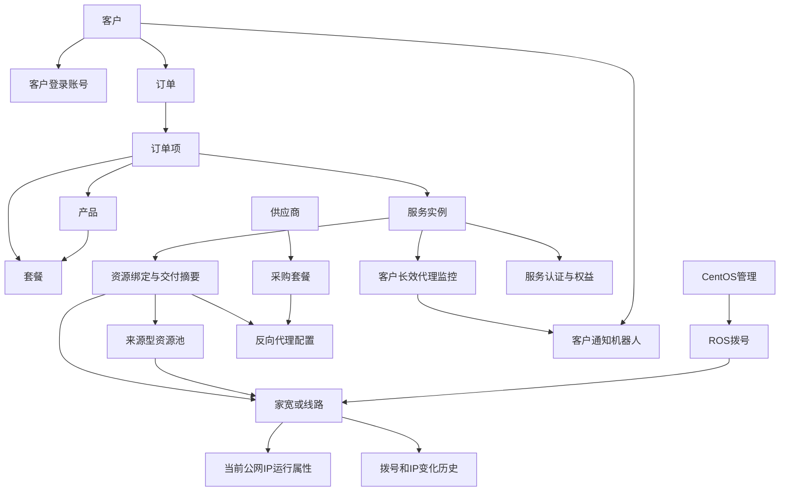
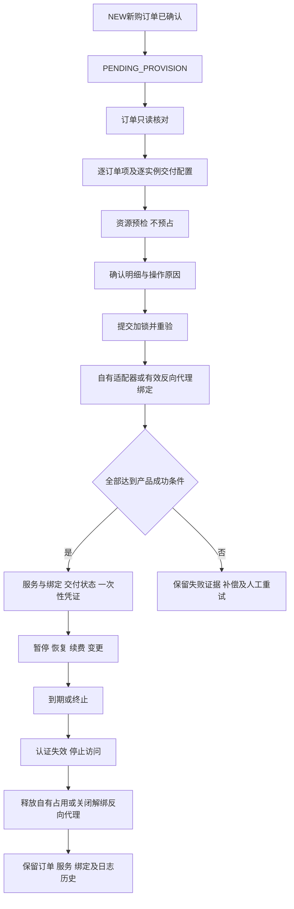

# 竞品系统分析及IP代理管理平台V1.2差异报告

> 更新：核心业务差异已完成用户逐项确认，见[业务确认记录](business-confirmations.md)。其中备用线路/主备切换入口及套餐续费宽限期为新增方向；宽限期先停服、保留固定IP，续费后恢复。下文原正式基线与调研发现保留为历史证据，范围判断以该确认记录的澄清为准。

调研日期：2026年10月14日（Asia/Taipei）  
对象：彩虹代理 IP代理服务管理系统  
入口：http://www.caihongdaili.com/  
方法：用户登录后的只读页面研究、少量不提交的表单交互、正式需求与指定分支源代码对照。

## 1 主要结论

竞品以主机、节点、ROS、客户套餐、消费和独立VPN业务组织后台，能够从资源运行状态追踪到客户绑定与提取记录，但没有在已查看页面中呈现V1.2统一的“订单项→服务实例→资源交付”五步闭环。此结论为**页面观察**，不代表竞品后端不存在其他流程。（E01–E25、E33、E36、E43）

V1.2的线路主引用、来源型资源池、外部采购与反向代理分层、订单驱动开通、受控凭证和客户专项告警，应继续作为正式设计依据。竞品的直接客户套餐发放、ROS主备切换、明文密码列表和运营余额体系不能直接覆盖这些已确认边界。（B01 §§1.3、6、8、11；E04、E09、E10、E23、E34）

当前指定分支的主要风险集中在**开通后的生命周期**，而非缺少五步开通页面：静态代码可见外部服务续费未校验采购期限，暂停/恢复未联动反向代理，终止未清除代理服务占用；服务变更页仍使用技术ID及JSON结果。正式开通页已经实现逐订单项与逐实例选择，静态原型却仍以单实例文字演示为主。以上是**页面观察〔代码静态读取〕**，未在正式系统运行验证。（G03–G08）

建议优先处理P0外部服务生命周期与跨客户资源归属校验；其次处理P1产品资源约束、资源接口标识核对、续费凭证期限、变更交互、交付摘要和失败补偿；运营财务、云手机、内容管理作为独立范围讨论。（差异矩阵D01–D18）

## 2 基线与证据规则

### 2.1 正式需求基线

**B01**：用户上传《IP代理管理平台需求说明书（V1.2-服务开通闭环修订版）.docx》。按用户指定的101页版本作为正式基线；本次按正文章节定位，未重新渲染分页，因此不编造页码。

SHA-256：`59f3716e85f073c92d64818636766ec1d8424a310d974f5f2ce773f394d7f396`。

此哈希与指定分支[正式需求索引](https://github.com/sunkai-hit/IP-proxy-platform/blob/feature/v1.2-full-upgrade/docs/requirements/README.md)公示的正式Word一致。上传文件名为“修订版”、仓库索引称“最终版”，二进制哈希一致，不能仅因名称不同判定为两个版本。

**B02**：[服务开通闭环设计与实现说明](https://github.com/sunkai-hit/IP-proxy-platform/blob/feature/v1.2-full-upgrade/docs/project-progress/V1.2-服务开通闭环设计.md)。属于专题实现说明，不替代B01。

**B03**：`feature/v1.2-full-upgrade`分支。经分支引用复核，读取版本提交SHA为`298ccb301565317cb6fb91fd515ae8215369d6c4`，不是运行部署版本。本报告保留关键文件Blob SHA及本地参考副本。本次上传只新增调研材料，未修改业务代码。

**B04**：该分支`prototype/index.html`及其实际加载的V1.2脚本。原型结论来自入口加载关系和源码只读观察；未将模拟数据或模拟成功当作真实交付证明，也未完成原型浏览器视觉与交互验收。

根README保留M1–M8历史口径，不能用其中“统一IP池”“配置产品资源策略”“六类监控”等旧说明替换B01。原型README亦保留ROS主备/B/C段旧描述，实际入口加载的`v12-infra-ui.js`已覆盖这些字段。（G01、G02、G09）

### 2.2 四级结论

|等级|本报告含义|不能证明的事项|
|---|---|---|
|实际操作验证|明确执行了某项低影响交互并看到了结果|不自动证明后台业务执行、资源下发或权限有效|
|页面观察|实际读取页面字段、按钮、列表或截图；代码证据注明“代码静态读取”|按钮存在不等于能力可用，状态显示不等于真实网络状态|
|未验证|未执行、未进入详情或未取得必要证据|不得写成“功能不存在”或“业务已成功”|
|推测|根据已观察关系提出的解释或潜在影响|需另行验证，不能作为正式需求变更依据|

实际操作验证仅包括：U01展开菜单并进入所记录页面；U02在离线通知新建表单点击“增加分组”，出现分组名、ROS主机和ROS线路区域；U03展开客户套餐选择框，显示套餐列表。U02/U03均未保存。真实开通、充值、兑换、审核、延时、终止、资源释放、重拨、切换、远程、DNS同步、发送通知、删除和导出均**未验证**。

### 2.3 可复核材料与边界

页面证据索引见附录A；早期页面保留字段观察记录于`research-progress.md`，后期页面另有`research-evidence/E*.txt`脱敏字段摘录。首页截图为`research-evidence/E01-dashboard.png`。摘录不是全量原始DOM或完整录屏；通过索引中的菜单路径、页面标题及字段可复核。

未保留竞品的明文密码、私钥、机器人URL、身份证原文或客户联系方式。报告中的数量与历史样本为读取时快照，不代表容量承诺、价格有效性或实时健康。当前为超级管理员视角，没有验证普通角色权限隔离。

留言板管理、疾病管理、短信管理、完美日记四个菜单**未进入**。其他页面中出现同名客户或顶部链接，不作为该排除模块的研究。资讯与微信工具只做辅助范围识别，其中资讯部分子页、微信工具内页未深入，详见附录A。

## 3 竞品功能地图

|一级模块|实际观察到的二级入口|V1.2映射与证据等级|
|---|---|---|
|主页|控制台|首页工作台；页面观察E01|
|主机管理|主机列表、共享测试、主机IP池、每日IP统计|CentOS、历史IP统计；共享测试执行未验证；E02、E16、E17|
|节点管理|节点列表|家宽/线路运行视图；页面观察E03|
|ROS管理|ros主机、域名绑定列表、ros逻辑线路、客户ROS、rosvpn提取记录、多多云手机ROS、离线数量通知、VPN拨号重复池、域名ip变更日志、备选线路列表、用户线路、主备切换|ROS、线路、域名、客户接入、日志、专项规则；V1.2主动排除ROS主备；E04、E05、E18–E22、E36–E40|
|产品管理|ROSVPN产品、彩虹币列表、外部产品使用记录、外部产品、Edge代理、JY管理、共享产品、独享产品|多种产品/供应交付方式混排；非五类产品一一对应；E06–E09、E30–E32|
|客户管理|企业认证审核、RosVPN套餐、客户手机列表、个人二次审核、客户列表、代理独享套餐|客户、认证、账号联系信息、套餐权益；E10、E11、E41–E44|
|消费管理|提取量统计、独享客户IP列表、共享消费、消费统计|提取日志、独享分配、消费及统计；E12–E15|
|VPN管理|VPN私钥管理、VPN订单管理、VPN产品管理|独立VPN交易/凭证链；E23–E25|
|卡密管理|卡密列表|兑换型权益入口；E29；V1.2主线是否纳入待确认|
|充值管理|充值列表|运营余额/支付；E28；属于隔离运营分支|
|系统管理|角色管理、权限管理、配置组、配置项、登录日志、操作日志、监控日志、用户管理|权限、参数、审计、进程监控；E26、E27、E45–E50|
|资讯管理|轮播图管理、分类管理、标签管理、文章管理|内容运营；文章字段已观察E51，其余仅菜单观察|
|微信工具|短信信息记录、微信注册|菜单观察；业务内页未验证；不能据名称推定与IP交付的关系|

竞品没有在全局菜单中展示独立“统一订单与服务中心”“长效IP”“隧道”“来源型线路资源池”。这是**菜单观察**，不是不存在这些业务的结论。

## 4 资源模型与对象关系

### 4.1 竞品可见关系

|关系|证据|等级与边界|
|---|---|---|
|主机→节点|节点行显示宿主机名；主机显示节点数量|页面观察E02/E03；实际外键和同步协议未验证|
|节点→拨号账号、端口、当前IP|节点列表具有HTTP/SOCKS5、账号、IP、重启间隔|页面观察E03|
|ROS→逻辑线路|逻辑线路显示rosId、线路ID、别名、账号、IP|页面观察E05|
|逻辑线路→客户/域名|线路显示用户/域名；用户线路页汇总绑定主机、线路、域名|页面观察E05/E18/E21；绑定写操作未验证|
|客户→套餐权益|客户套餐显示客户、套餐、数量、生效/到期、添加方式|页面观察E10/E43；实际计费与分配未验证|
|客户→独享IP历史|独享客户IP列表显示用户、IP、开始/结束|页面观察E12；未证明独享冲突检测|
|外部产品→客户→提取记录|外部产品绑定用户；使用日志显示产品/用户/数量/结果|页面观察E09/E32|
|客户ROS→接入凭证|IP、端口、用户名和密码字段|页面观察E20；实际登录/代理连通未验证|
|VPN订单→用户/产品/支付/周期/地区|VPN订单表字段|页面观察E23；订单与私钥的关联未验证|
|ROS主备→原线路/备选线路/域名|主备页并列显示两侧线路及IP|页面观察E39；切换效果未验证|

**推测**：竞品存在多个并行交付体系，部分“客户套餐”可能负责权益，线路/代理页面负责实际资源入口。需要提交与数据面证据才能确定完整执行链；不能把这些页面拼接关系描述成已经端到端验证。

### 4.1.1 调研后资源关系确认

2026年10月14日，用户补充：CentOS与ROS一一对应是竞品运维向用户说明的关系，当前阶段暂按该关系设计；用户同时确认ROS逻辑线路与节点是同一对象，可通过所属ROS与拨号账号对应起来。

当前设计统一为：**CentOS ↔ ROS（1:1）→ 家宽／线路（ROS逻辑线路＝节点）→ 当前公网IP及端口等运行信息**。节点列表与ROS逻辑线路列表按同一线路的不同业务视角理解，不据菜单拆分为两套独立资源主数据。

证据来源：用户提供的业务澄清，其中1:1关系由用户转述竞品运维确认，属于本次设计依据；不标记为浏览器实际操作验证。CentOS与ROS对应关系的疑问关闭。此前同账号出现多条记录的页面现象保留，但不据此改变当前模型；稳定来源ID、重复记录与同步映射在接口联调时核对。所属ROS＋拨号账号是当前关联识别条件，不据本次确认擅自设定数据库唯一约束。

### 4.2 V1.2应保留的关系

图为**正式需求关系整理**，不是竞品后端ER图。当前CentOS↔ROS按1:1；同一线路可加入多个来源池；IP变化不改变线路、池成员或服务主引用；客户通过服务/绑定关联资源。独享/VPN/隧道不作为池成员类型，外部采购不默认进入自有池。（B01 §§1.3、6、14、15）

### 4.3 模型疑点

1. **资源对应关系已澄清，接口标识仍需核对**：用户确认当前CentOS与ROS按1:1，ROS逻辑线路＝节点＝家宽／线路，按所属ROS及拨号账号对应。原“多拨导致统一模型失真”的推测不再作为当前模型调整依据。E03同账号多记录现象保留，后续接口联调核对来源ID及重复记录，不按变化中的IP建立主引用。见§4.1.1。
2. **去重容量，P1，推测待确认**：E05多条ether线路可共用当前IP。线路数、在线会话数、去重公网IP数、B/C段覆盖数是不同指标。多池重叠时跨池总量应按线路ID或对应统计对象去重，不能累加池内数量。
3. **历史池语义，页面观察**：竞品“主机IP池”打开每日主机IP统计E16；不等同于V1.2来源型线路资源池，不能沿用名称直接迁移主数据。
4. **独享隔离粒度，P1，推测待确认**：若同一账号多会话属于同一物理带宽，按逻辑线路锁定是否足以实现“独享”，需业务明确独享承诺是线路、会话、带宽还是出口IP。

## 5 五类产品与套餐对照

|V1.2类型|竞品证据|已观察配置|未验证与差异|
|---|---|---|---|
|短效IP|共享产品E06、节点E03|稳定时长范围、彩虹币价格、在售状态；节点可用时间/人数/重启间隔|映射为短效是推测；实际最低剩余寿命、提取频率、去重窗口、扣费触发未验证|
|长效IP|用户线路E21、域名E18、Edge E30、JY E31可提供固定接入线索|线路、域名、网关、数量、期限等|没有同名独立菜单；不能认定这些对象就是长效产品；保持/更换规则未验证|
|独享IP|独享产品E07、客户套餐E10、独享IP列表E12|IP数量、天数、价格、客户周期、历史IP|冲突与资源释放未验证；负数“套餐”疑似调整工具，不能直接转为销售套餐|
|VPN|ROSVPN E08/E43、VPN产品E24、订单E23、私钥E25|ROSVPN按天/IP数/彩虹币；另一VPN产品按秒/元/类型；私钥按主机/起止维护|两条链路是否同一数据面未验证；协议、设备数、证书发放和吊销未验证|
|隧道|Edge代理E30提供网关、白名单、账号密码、限速、时效、权重|具备入口型代理配置特征|映射为隧道仍是推测；固定入口、并发、会话保持、转发实现未验证|

共享产品样本中“10分钟”对应范围5–10；独享样本出现“-10”等负额度及零价格；VPN时长有秒和天两种单位。上述均为**页面观察**，不证明数据错误。建议V1.2明确：套餐名称与结构化权益分离；单位显式展示；普通销售数量为正，调整额度由独立变更单承载；价格调整不覆盖既有订单和服务快照。（B01 §§7、8）

资源策略应由代码按产品地区、运营商、资源可用性及容量执行。已有配置字段不等于规则被执行；见D05。

## 6 核心业务流程

### 6.1 竞品可复核链路

|链路|可见步骤|证据等级|
|---|---|---|
|共享代理|客户/余额→共享产品→节点→共享消费→提取/消费统计|每个页面为页面观察E03/E06/E11/E13–E15；箭头执行关系为推测|
|独享权益|独享产品→添加客户套餐→生效/到期/数量→独享客户IP列表→延时|表单与选择框实际操作验证U03；业务发放、续费和释放未验证|
|ROSVPN|ROSVPN产品→客户ROSVPN套餐→线路/客户绑定→提取记录|页面观察E08/E20/E36/E43；实际拨号连接未验证|
|独立VPN|VPN产品→VPN订单/支付/周期→私钥与主机|页面观察E23–E25；订单与私钥自动关联为推测|
|外部代理|外部产品/Edge/JY配置→绑定客户→外部提取使用记录|页面观察E09/E30–E32；采购及反向代理生命周期未验证|
|域名维护|线路当前IP→域名绑定→DNSPOD同步入口→变更日志|页面观察E05/E18/E19；自动同步触发和回滚未验证|
|离线通知|规则→周期→ROS主机/线路分组→企业微信机器人|表单结构页面观察E34；添加分组验证U02；真实检测和发送未验证|

已查看套餐创建页直接选择用户名、套餐和生效时间，未显示订单项、预检、逐实例分配；这不是V1.2普通开通流程的替代。它只可作为受限人工开通入口的交互参考。

### 6.2 V1.2开通与后续闭环

图为B01第8章整理。RENEW/EXPAND/CHANGE不走新购开通；外部服务不得超过采购覆盖周期；终止不自动取消供应商采购。管理面ACTIVE与真实数据面可用必须分开。失败后数据库回滚不保证外部设备操作回滚。

## 7 监控 日志 统计与运营

|能力|竞品观察|V1.2处理|
|---|---|---|
|资源运行|主机CPU/内存/负载/心跳；ROS资源、线路在线数/上报；节点延迟与最近拨号|已有需求，借鉴关联摘要；标明采集时间与过期UNKNOWN；E02–E05|
|进程运行|系统监控日志实际是服务名称、端口、进程数、内存、请求数、启动/运行时间|独立的应用运行观测，可选扩展，非新增ROS职责；E27|
|客户专项告警|离线通知按周期和ROS分组，仅企业微信|分组交互可借鉴；V1.2仍按客户+服务+代理目标和钉钉/飞书；E34|
|提取与使用|提取量、共享消费、去重/不去重使用量分页面|保留不同日志来源；竞品“使用”触发口径未验证；E13–E15|
|IP历史|每日主机IP数量、总/去重IP数、域名IP变更、ROSVPN提取线路快照|分别说明当前库存、周期新IP、历史去重、真实出口使用；E16/E17/E19/E36|
|操作与登录审计|地址、请求方式、参数、修改内容、操作者、时间；登录IP/UserAgent|保留失败、敏感字段脱敏、限制删除；竞品权限效果未验证；E26/E49|
|权益与金额|余额、彩虹币、充值前后、消费前后、卡密兑换、人工延时|属于独立运营需求分支或新增范围讨论；E10/E11/E14/E28/E29|

**推测与建议**：应为“可用时间”“稳定时长”“正在使用”“限制人数”“IP使用去重”等指标提供定义和计算时间。截图E01在当前窗口中有数值截断与文字挤压，不能只依靠卡片大数判断容量。B/C段统计继续归CentOS，不能因竞品ROS或历史原型字段而迁回。

## 8 逐项差异与优先级

P0：隔离、真实服务停止、资源占用或期限边界可能失守，正式上线前解决。  
P1：影响正确交付、业务选择与排障，V1.2验收前处理。  
P2：交互及可观测性改进，排期优化。  
“需求疑点”要求先确认口径；“实现差异”已有正式条款；“有意边界”不应误列遗漏。

|编号|优先级/性质|证据等级与定位|发现及影响|建议与验证标准|
|---|---|---|---|---|
|D01|P0 实现差异|页面观察〔代码〕G04/G05/G07；B01 §§8.6–8.9|续费只修改服务到期；暂停/恢复只改凭证和服务状态；终止未在该链清除反向代理service_id。外部入口生命周期未闭环|按交付方式分支；调用反向代理适配器，重验采购/代理期限与状态；解绑占用。测试服务暂停后入口不可访问、期限不足续费被拒、终止后可安全再分配|
|D02|P0 实现差异|页面观察〔代码〕G03/G04/G08；B01 §8.4.2|创建代理允许单独传customerId；开通查询取得purchase_customer_id但未比较采购客户与服务客户|统一校验服务、代理、采购客户；已绑定采购/代理变更保护；跨客户组合必须拒绝；采购更新与开通并发须原子一致|
|D03|P1 实现差异|页面观察〔代码〕G05/G07；B01 §8.7|续费仅更新svc_instance.expire_at，当前读取链未同步凭证与独享占用期限|明确续费订单引用、权益/凭证/占用同周期更新；测试原到期时间后服务和认证一致；到期服务续费与恢复规则需明确|
|D04|业务已澄清／接口待核对|用户业务确认（1:1由用户转述竞品运维）；页面观察E03/E05|当前CentOS↔ROS按1:1，ROS逻辑线路、节点统一为家宽／线路。原模型失真推测不作为本轮变更要求|按所属ROS与拨号账号关联；联调核对稳定来源ID和同账号多记录；不因IP变化改主引用，不擅自新增唯一约束|
|D05|P1 实现差异|页面观察〔代码〕G06；B01 §7.9|BuiltinResourcePolicy接收产品等ID，但选池/选线未使用产品地区、运营商及套餐条件；只按类型、在线数量、优先级/延迟/容量|代码规则落实销售范围与容量；可用资源在错误地区时必须拒绝或按明确规则处理，不能静默交付|
|D06|P1 交互差异|页面观察〔代码〕G05；B01 §§8.5、18.4|服务变更页手输服务ID、JSON结果，终止无页面二次确认；结果FAILED亦可能统一提示“完成”|从服务详情带入或可检索选择；显示客户/服务号/类型/资源/影响，终止确认；按业务结果展示成功/部分/失败|
|D07|P1 交互差异|页面观察〔代码〕G03；B01 §8.2|开通确认页只显示方式和实例数；结果页未直接列实际绑定资源与访问入口|确认与结果逐实例列代理号、入口、线路/池、期限、交付阶段；预检资源为快照，实际结果以提交返回为准|
|D08|P1 原型覆盖差异|页面观察〔代码〕G02；B01 §§8.2.1–8.2.4|原型样例count=1，外部选择仅模式和说明，无代理候选选择、多订单项/多实例计划及失败演示|补充可评审交互样例；与正式页对齐。此项不能反推后端缺少逐实例实现|
|D09|P1 失败闭环差异|页面观察〔代码〕G03；推测运行影响；B01 §8.2.3|所读开通路径的失败通过异常回滚；本地事务无法保证已调用外部设备回滚，当前路径未见持久补偿编排|独立执行任务、幂等键、尝试记录、失败审计、补偿/重试边界；模拟第二项失败时第一项已下发的场景。全仓其他补偿机制未验证|
|D10|P1 到期与状态疑点|未验证/页面观察〔代码〕G07/G10；B01 §§8.9、16.5|所读RuntimeScheduler只包含监控/统计；独享回收写PENDING_RECYCLE，需求使用PENDING_RELEASE；未取得全量到期任务证明|核对所有定时入口及状态映射；验证到期入口关闭、占用回收、重试、审计；不得仅凭列表状态宣称释放完成|
|D11|P1 产品语义疑点|页面观察E06–E08/E24/E35；推测含义|分钟范围、天、秒和价格单位混用；负数量记录可能承担人工调整|名称与权益分离；时长/金额单位固定或显式转换；调整单不混入正常套餐；验证边界与快照|
|D12|P1 权限交互差异|页面观察〔代码〕G03/G04；B01 §8.2.1|预览要求service:provision，提交要求order:provision，外部另有权限；前端仅检查提交通用权限，外部选项未按外部权限隐藏|制定可组合角色矩阵；前后端一致授权；测试只读、内购开通、外部开通、手工开通四类角色|
|D13|P2 已有需求的强化|页面观察E01/E16/E17/E37；B01 §§4、12|线路/IP/去重/B-C段、库存/历史/使用等口径易混淆，多池重复计数有风险|指标定义、时间范围、来源及过期时间可见；跨池汇总按真实对象去重；用同IP多线路、多池重叠样例验收|
|D14|P2 可借鉴交互|页面观察E21/E39；B01 §§5、8.3、15|竞品将客户绑定主机/线路/域名数量集中呈现，关联排障直接|在服务详情集中显示客户、订单项、产品快照、线路/代理入口、日志、告警和释放记录；按服务绑定查看，不把客户字段塞回线路主表|
|D15|P2 可借鉴交互|实际操作验证U02；页面观察E34；B01 §11|告警分组配置简单，但只支持企微，与V1.2客户专项渠道不同|借鉴添加/移除检测对象分组；保留客户和服务归属、检测方式、失败阈值、恢复通知与钉钉/飞书；不直接复用竞品渠道模型|
|D16|P1 保留安全要求|页面观察E09；B01 §§1.3、6.9、18.3|竞品外部产品密码列出现可读值；其他页面也有密码字段|默认掩码、独立权限、审计和受控一次性展示；URL中Token亦脱敏；不在报告或日志保存凭证|
|D17|P2 文档同步差异|页面观察〔代码〕G01/G09；B01 §§1.3、6|根README和原型README保留旧资源/监控/ROS职责；入口脚本已覆盖部分旧原型实现|需求索引标明历史材料；以真实加载脚本/接口为依据更新说明；避免旧字段误导新研发|
|D18|范围边界|页面观察E04/E28/E29/E40/E51；B01 §1.3|ROS主备、财务余额、卡密、云手机、内容运营等竞品特性|ROS主备与财务为本版有意边界；其余进入独立范围评估，不因竞品存在就判定V1.2遗漏|

D01/D02为静态调用链可见的实现缺口；实际部署是否另有网关层、拦截器、触发器或不同代码补足，未验证。验收需从当前分支构建的测试环境确认，不应在竞品生产后台试验。

### 8.1 已覆盖而不应重复新增

|正式章节|已有要求|竞品研究后的处理|
|---|---|---|
|§4 首页|客户/服务/资源/告警摘要、当前去重IP|保留并改善卡片可读性和口径|
|§5 客户|认证、账号、服务引用、使用概览|补清人工复审层次；余额/来源不并入主线|
|§6 资源|CentOS/ROS/线路/池/独享/域名/供应商/采购/代理|继续分层；1:1及线路统一已确认，联调核对来源标识与独享粒度|
|§7 产品|五类专项参数、套餐、代码规则|关键在执行约束和单位，而非再建通用策略编辑器|
|§8 订单服务|五步开通、混合交付、原子重验、失败处理、生命周期|已有需求；主要是实现与原型覆盖差异|
|§9 监控|CentOS/ROS及数据时间|不扩回旧六类通用监控页面|
|§10 日志|提取/使用/API/拨号/IP变化/远程/域名/外部/操作|保留真实来源、失败证据及脱敏|
|§11 专项告警|客户/服务/代理目标/机器人/异常恢复|竞品离线分组不替代该模型|
|§12 统计|资源、线路、IP、池、客户、产品服务、外部交付|避免历史IP量冒充当前容量、提取冒充流量|
|§13/18 系统非功能|权限、审计、敏感保护、确认、性能与容错|用角色和失败场景验证，不以按钮存在代替验收|
|§14–17/19 关系状态接口待确认|线路主引用、资源职责、数据过期、协议边界|补充身份/时长/检测及状态映射的具体确认项|

## 9 可借鉴方案与实施次序

1. **先完成交付安全闭环**：外部代理暂停/恢复/终止/到期联动、采购期限和跨客户校验、凭证与独享期限一致、失败补偿。每项给出管理状态和真实执行结果，不用单一ACTIVE掩盖未下发。
2. **再完成业务可评审交互**：服务选择使用业务名称；变更前展示影响；开通结果逐实例展示访问入口和资源；异常给出可处理原因与重试路径。普通开通保留订单向导，人工直开独立权限。
3. **明确资源与统计口径**：遵循已确认的1:1和统一线路模型，联调核对来源标识；明确独享隔离、最小剩余寿命、去重窗口、多池汇总和数据过期。采用竞品的资源/使用趋势，但同时展示数量定义和更新时间。
4. **补充原型场景**：同订单两种产品、自有与外部混合、每项多个服务、无候选代理、采购不足、独享不足、提交时冲突、适配器未配置、部分下发后的补偿、已开通防重。只作为后续建议，本次未修改。
5. **独立评估运营扩展**：财务、卡密、云手机及内容运营进入独立需求池；不改动已隔离的运营反馈分支。

建议在授权的测试环境执行以下验收：同订单并发开通、多实例代理防复用、跨客户采购/代理组合拒绝、独享不足整单拒绝、产品地区错配拒绝、采购期限不足续费拒绝、暂停入口不可访问、恢复重验、终止后释放占用、到期自动处理失败重试、凭证续期、失败审计及普通角色权限。以上均为**未验证的后续验收建议**，本次没有执行。

## 附录A 页面证据索引

所有列表/表单字段记录均为“页面观察”；U02/U03另有明确实际操作验证。未列出的写操作仍是未验证。外层后台使用iframe，地址栏可能保持`/admin?%2Fadmin%2F=`；因此以内层页面标题和菜单路径复核。确实读取到的URL才列出，未猜测路由。

|证据|菜单路径或已观察URL|可复核内容|
|---|---|---|
|E01|主页→控制台 `/admin/index`|在线节点/主机、去重IP、时效容量/在用、小时/日趋势；截图|
|E02|主机管理→主机列表 `/admin/host`|CPU/内存/负载/硬盘、IP池数、节点数、心跳、延迟/监控/远程入口|
|E03|节点管理→节点列表|宿主机、账号、HTTP/SOCKS5、IP、类型、人数、重启、可用时间、最近拨号|
|E04|ROS管理→ros主机|资源、线路在线数、记录名、主备/替换/切换/上报|
|E05|ROS管理→ros逻辑线路|rosId、用户、域名、IP、账号、监控重拨、地区/运营商|
|E06|产品管理→共享产品；创建链接 `/admin/product/create`|名称、稳定时长范围、价格彩虹币、在售|
|E07|产品管理→独享产品；创建 `/admin/package/create`|数量、天数、价格、负数量样本|
|E08|产品管理→ROSVPN产品；创建 `/admin/rosvpn/create`|数量、天数、彩虹币|
|E09|产品管理→外部产品；创建 `/admin/exip/createSource`|源网址、客户、认证、提取时效秒、状态；密码展示行为已脱敏记录|
|E10|客户管理→代理独享套餐；创建 `/admin/memberpackage/create`|客户、套餐、起止、数量、添加人/方式、延时历史|
|E11|客户管理→客户列表|余额/来源/IP数/到期/实名/类型/钉钉/禁用|
|E12|消费管理→独享客户IP列表|用户、IP、开始/结束|
|E13|消费管理→提取量统计|会员、日期、IP提取量|
|E14|消费管理→共享消费|消费单号、会员、金额、余额前后、IP、创建|
|E15|消费管理→消费统计|去重/不去重使用、金额、日期、时间|
|E16|主机管理→主机IP池|实际标题“每日主机IP池统计”，主机/日期/IP数|
|E17|主机管理→每日IP统计|日期、总IP、去重IP|
|E18|ROS管理→域名绑定列表|域名、IP、客户、状态、同步DNSPOD入口|
|E19|ROS管理→域名ip变更日志|ROS、域名、旧/新IP/时间筛选；类型、详情|
|E20|ROS管理→客户ROS|ROS IP、客户、端口、认证、备注|
|E21|ROS管理→用户线路|客户列表、绑定主机/线路/域名数量、ROS关联表|
|E22|ROS管理→离线数量通知|规则列表、状态、创建|
|E23|VPN管理→VPN订单管理|订单、支付、用户、产品、类型、金额、周期、地区|
|E24|VPN管理→VPN产品管理|时长秒、价格元、类型、状态|
|E25|VPN管理→VPN私钥管理|凭证名称、起止、主机；未读取/导出密钥内容|
|E26|系统管理→操作日志|用户、地址、功能、参数、请求方式、修改内容、时间|
|E27|系统管理→监控日志|实际进程运行视图：服务、状态、端口、进程、内存、请求、运行时间|
|E28|充值管理→充值列表|兑换比率、支付、余额前后、状态|
|E29|卡密管理→卡密列表|兑换人、金额、状态、套餐、时长、IP数|
|E30|产品管理→Edge代理；表单 `/admin/exip_edge/create`|网关、时效、限速、白名单、认证、权重、用户|
|E31|产品管理→JY管理|账户、客户、节点数、剩余天数、到期|
|E32|产品管理→外部产品使用记录|用户、外部产品、提取数、结果、时间|
|E33|`/admin/memberpackage/create`|用户名、套餐、生效、备注；U03展开套餐框|
|E34|`/admin/rosnotice/create`|仅支持企微、周期默认15分钟；U02增加ROS/线路分组|
|E35|`/admin/vpnProduct/create`|时长秒、价格元、上架、类型默认独享|
|E36|ROS管理→rosvpn提取记录|线路ID、IP、客户、类型、操作时间|
|E37|ROS管理→VPN拨号重复池|名称、周期秒、线路数、备注|
|E38|ROS管理→备选线路列表|备份ROS、线路账号、域名、客户、上报|
|E39|ROS管理→主备切换|原/备线路ID、ROS、IP、绑定域名；未切换|
|E40|ROS管理→多多云手机ROS|云手机ID筛选、线路IP、ROS接入、线路数|
|E41|客户管理→企业认证审核|企业、统一社会代码、执照、状态、审核人；未审|
|E42|客户管理→个人二次审核|已实名后的人工复审、状态、审核人/时间；未审|
|E43|客户管理→RosVPN套餐|客户、套餐、数量、周期、添加方式|
|E44|客户管理→客户手机列表|客户、手机号、创建|
|E45|系统管理→角色管理|名称、显示名称、创建/更新|
|E46|系统管理→权限管理|权限名、路由、类型、图标|
|E47|系统管理→配置组|分类、排序、创建/更新|
|E48|系统管理→配置项|配置界面与确认入口；参数内容/保存/生效未验证|
|E49|系统管理→登录日志|时间/用户筛选、IP、请求方式、UserAgent|
|E50|系统管理→用户管理|用户名、昵称、联系方式、创建/更新|
|E51|资讯管理→文章管理|分类、标题、标签、类型、点击量、创建/更新|

**仅菜单观察/内页未验证**：主机“共享测试”、产品“彩虹币列表”、资讯“轮播图/分类/标签”、微信工具“短信信息记录/微信注册”。共享测试未执行，避免未知测试动作影响真实资源。长效/隧道同名模块、完整支付回调、订单与服务自动关联、终止/到期任务、低权限隔离均未验证。

## 附录B 仓库证据定位

所有路径位于指定分支；本地`research-references/`保存关键只读参考副本，不是对原仓库的修改。

|证据|文件/关键定位|Blob SHA或定位说明|
|---|---|---|
|G01|`README.md`、`docs/requirements/README.md`|历史实现说明与正式基线优先级|
|G02|`prototype/index.html`、`prototype/v12-provision-flow.js`|入口SHA `5208b19f4fa659c593310c5479ce91c4643606a2`；向导SHA `d410b22afd46d0793cb2f401e725a54d6924a0f4`；demo/count、modal步骤1/2|
|G03|`frontend/src/views/service/ServiceProvisionView.vue`；`service/v12/V12ServiceLifecycleService.java`|SHA `938c5998430b0500d25b83e86dfa842a845981b7` / `40fa44dad6fa9300d43a0ab0ce89c0db553e3633`；confirm、step3/4、provisionOrder、provision|
|G04|`backend/.../service/OrderServiceController.java`|SHA `548107cacb40fb21bbcb70941f2b3fc184c557c2`；suspend/resume/renew/terminate委托与权限|
|G05|`frontend/.../ServiceChangeView.vue`；`backend/.../service/OrderServiceService.java`|后者SHA `f9b18920030c209be5c084049c677cd46ade38f2`；submit模板；suspend/resume/renew/terminate|
|G06|`backend/.../service/v12/BuiltinResourcePolicy.java`|SHA `babb638fb5a2db66bd89ca36a00c40bf80b8b740`；decide/findPool/findLine|
|G07|`backend/.../service/mapper/OrderServiceMapper.java`|renew、releaseBindings、recycleExclusive；读取副本定位方法名|
|G08|`backend/.../resource/external/ExternalDeliveryService.java`；`service/v12/V12ServiceMapper.java`|SHA `7d313f0fb11f1ded48c720f81d207470657edd91` / `0632f7af9e237a448b9945a3ec94f7038145515e`；createProxy/validateProxy/lockedReverseProxy|
|G09|`prototype/v12-infra-ui.js`、`v12-pool-model.js`、`v12-console-ui2.js`|SHA `fad446b8d8ea19f37ca8603824a78c3d8a3dd1ad` / `ea4d38a457c38a03f9b90bac5be5b23a7f794bae` / `e14283937536b12ff5d4ed0fa633b1384f9530b4`；实际覆盖函数与最终导航|
|G10|`backend/.../runtime/RuntimeScheduler.java`、`service/adapter/NoopServiceProvisionAdapter.java`|监控/统计定时入口；Noop VPN/隧道拒绝，其他返回管理面逻辑结果；不证明真实网络交付|

`backend/...`完整根为`backend/src/main/java/com/ipproxy/platform/`；`frontend/...`完整根为`frontend/src/views/service/`。G10只反映所读文件，不作为“全仓没有其他定时任务”的证明。

本次产出仅为研究报告、脱敏证据与参考副本；没有修改GitHub业务代码、正式需求文档或现有原型，也没有提交竞品业务变更。

## 调研后确认事项

2026年10月14日，用户确认竞品中的充值相关功能已讨论决定移除。充值能力不再作为本项目的待补功能；相关竞品观察仅保留为历史调研证据，不构成立项建议。报告其他核心业务差异将逐项与用户确认，未确认的推测不直接改写正式需求。
